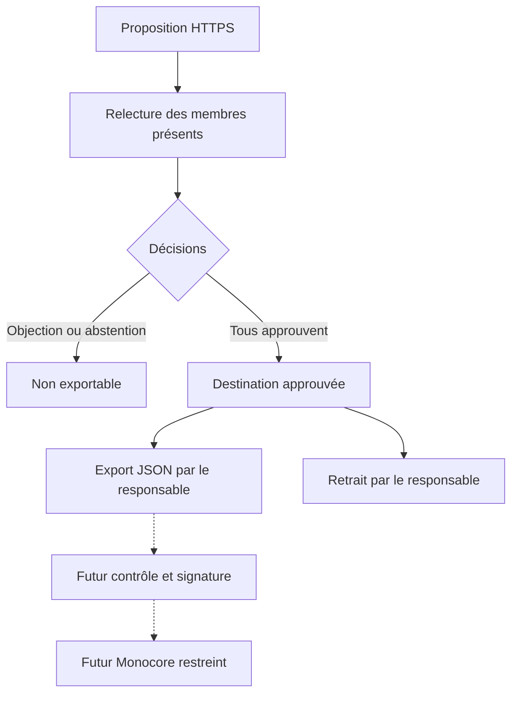

# Room : atelier collectif de destinations

## Disponible dans le prototype 0.17.0

L’atelier s’ajoute aux rooms existantes, sans modifier les trois étapes de disponibilité. Il possède sa propre liste de propositions. Tous les membres authentifiés qui ont lu l’introduction peuvent proposer un service. La Room continue à utiliser les identités par onglet et les événements `room:state` pour synchroniser les écrans.

### Règles explicites

- Jusqu’à 42 membres selon la room ; trois rooms actives par accès de test selon le socle existant.
- Jusqu’à 100 propositions par room. L’historique de l’atelier est borné aux 500 derniers événements ; ce n’est pas un journal permanent ou infalsifiable.
- Les relecteurs sont figés lors de chaque proposition. Les arrivants suivants n’entrent pas dans cette revue. S’ils doivent participer, retirer puis reproposer la destination.
- Une seule personne présente implique un seul relecteur. Ce résultat doit être présenté comme tel, jamais comme une certification collective étendue.
- L’auteur ne vote pas automatiquement pour sa propre proposition.
- Une objection empêche l’approbation. L’abstention et l’absence de vote ne sont pas des accords. Un relecteur peut modifier son vote en relisant la révision courante.
- Le départ d’un relecteur rend la proposition non exportable. La déconnexion seule ne retire pas son profil de la room.
- Le responsable peut retirer une proposition, mais ne peut pas approuver à la place des autres.
- L’URL d’une proposition ne se modifie pas : retirer et reproposer pour changer la destination et recommencer la revue.
- Les votes, les adresses et les motifs sont visibles dans cette room, pas dans les avis publics ni dans une liste marketing.

## Ce que signifie « approuver »

Cela signifie que le membre accepte d’inclure la destination dans ce brouillon. L’application ne vérifie pas que le membre a réellement ouvert le site, ni sa compétence. L’identité reste celle d’un profil de session, pas une identité civile certifiée. Deux codes utilisés par une même personne ne constituent pas deux expertises indépendantes.

La relecture humaine devrait porter sur l’adresse exacte, l’organisme représenté, la destination après redirection, l’activité annoncée, les conditions de service et les droits d’emploi du signe. Le prototype ne contacte pas automatiquement les URL proposées.

## Export et durée

Le schéma `monocore-group-map-draft`, version 1, contient uniquement les destinations approuvées, le nom du groupe, l’identifiant de room, une révision et une expiration. Les votes nominatifs, contacts et tokens ne sont pas exportés. Le nom de groupe peut toutefois identifier une structure : contrôler le fichier avant partage.

`signed:false` et `enforced:false` sont explicites. Monocore 0.4.1 n’importe pas ce fichier. L’export expire au plus tard avec la room, mais rien n’empêche techniquement de modifier un fichier local non signé. Il faut une autre chaîne de publication pour en faire une politique de navigation fiable.
